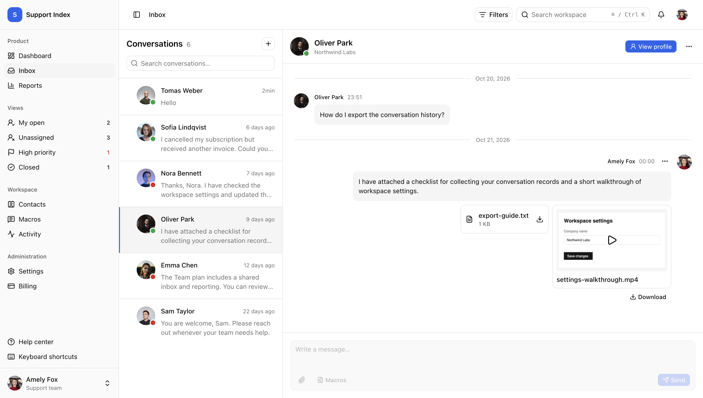
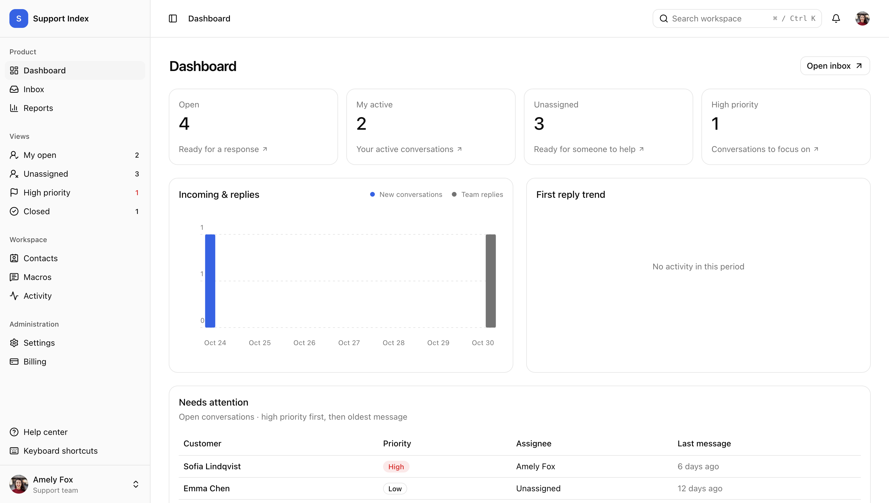
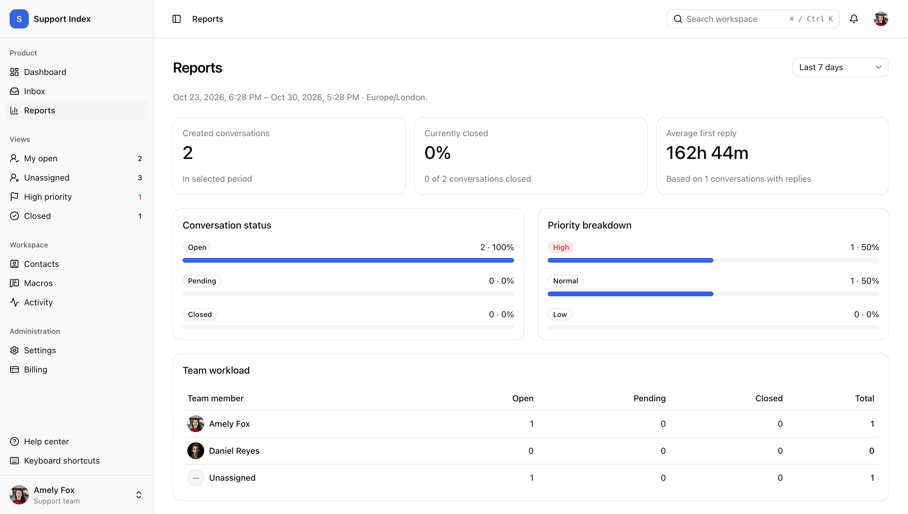
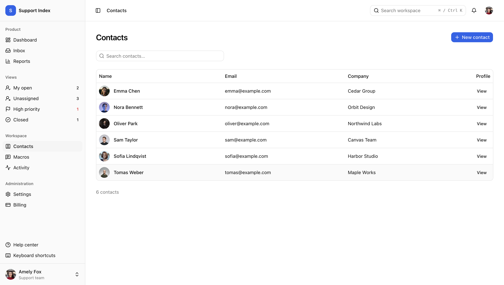
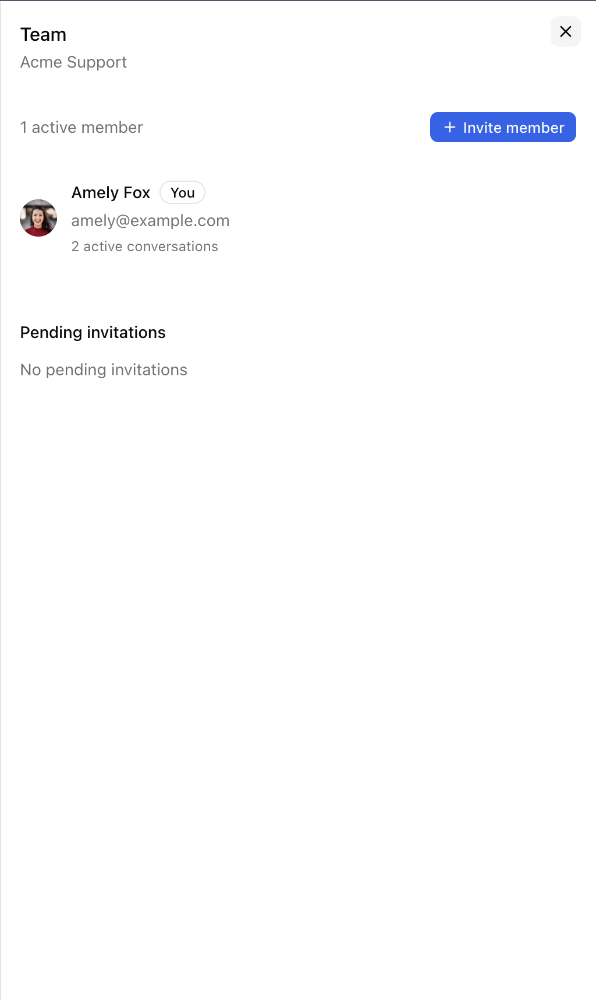
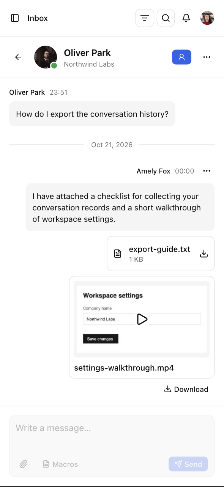

# Support Inbox

A shared customer-support inbox for teams that need the conversation, customer history and next action in one place.

 

## From incoming message to resolution

Assign a conversation, set its priority, reply with a macro and keep attachments in the thread. Open, pending and closed views make the next action clear without losing the customer's context.

Contacts, team invitations and notifications sit alongside the inbox. Activity and reports connect day-to-day work with conversation volume, first replies and workload distribution.

- **Inbox:** conversation history, assignments, priorities, status changes and attachments.
- **Contacts and macros:** customer records and reusable responses within reach of the conversation.
- **Team:** account-based membership, invitations and workspace updates.
- **Reporting:** dashboard metrics, period filters, conversation breakdowns and team workload.
- **Workspace settings:** account preferences, notifications and subscription billing screens.

## Screens

Dashboard and support reports

Contacts, team and mobile inbox

## Built with

Vue 3, TypeScript, Pinia, shadcn-vue and Tailwind CSS. The application backend uses Java 21, Spring Boot, Spring Security, Flyway and MySQL, with WebSocket updates.

## Demo

[Open the interactive demo](https://support-inbox-demo-brazhdev.pages.dev/). Choose a demo account on the sign-in screen.
